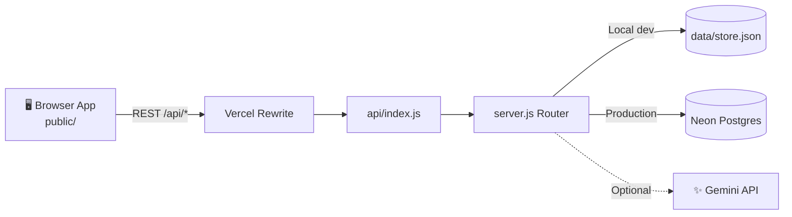

<div align="center">

# 📚 BookLeaf Support Desk

**Resolve author support queries in minutes — with AI doing the heavy lifting.**


[Live Demo](https://bookleaf-support-desk.vercel.app) · [Features](#-features) · [Architecture](#%EF%B8%8F-architecture) · [Getting Started](#-getting-started) · [API Reference](#-api-reference)

</div>

---

## 📌 Overview

BookLeaf Support Desk is a **full-stack author support portal and operations dashboard** built with Node.js and browser-native JavaScript. It uses a REST API, role-based access, optional server-side Gemini AI, and either a local JSON store for development or Neon Postgres for Vercel deployments.

> 🌐 **Live demo:** [BookLeaf Support Desk](https://bookleaf-support-desk.vercel.app)
>
> 🔑 **Demo accounts:** listed in [Getting Started](#-demo-accounts). These are shared evaluation credentials, **not production credentials**.

---

## ✨ Features

### ✍️ For Authors
- See **only their own** books and tickets.
- Raise support queries against a specific book or **"General / Account Level."**
- File selection is a **UI preview only**; attachments are not uploaded or stored.

### 🛠️ For Operations Admins
- Filter tickets by **status, category, priority, and date**.
- **Override** the AI estimates.
- **Assign** a ticket to themselves.
- Change **status**.
- Add private **internal notes**.
- Send **author-visible replies**.

### 🔄 Live Updates
Ticket changes refresh automatically about **every five seconds**, which works across stateless Vercel functions.

### 🔒 Security
- Passwords use Node's **scrypt** hashing.
- Sessions use **signed, HttpOnly, SameSite=Lax** cookies; `Secure` is added in production.
- Keep the app behind **HTTPS** in production and set a unique, strong `SESSION_SECRET`.
- **Never add `.env` or database credentials to Git.**

### 🤖 AI Assistance
Instant local triage, optional Gemini refinement, and human-reviewed reply drafts. See [AI Design](#-ai-design).

---

## 🏗️ Architecture



### Decisions

| Decision | Why |
|---|---|
| **Small Node.js service and browser-native UI** | Keeps the assignment easy to run and avoids a frontend build pipeline. `server.js` owns REST handling, authentication, validation, persistence, and Gemini calls; `public/` contains the browser app. |
| **One REST handler on Vercel** | `api/index.js` receives Vercel rewrites for `/api/*` and passes the original API path into the same router used locally. This keeps local and hosted behavior aligned. |
| **Neon Postgres in production, JSON file locally** | Neon keeps tickets and replies across stateless function invocations. The current app stores the complete state as **one JSONB record** to keep setup and migrations small for the assignment; a production version should normalize users, books, tickets, messages, and notes into relational tables. |
| **Polling instead of a persistent connection** | The author and operations screens refresh tickets every five seconds. This works with serverless functions and is simpler to deploy, at the cost of a short update delay and extra reads. |
| **AI as an assistant, not a dependency** | Local rules classify and prioritize a ticket immediately. Gemini can refine those values and draft replies, but admins review drafts and can edit every classification field. |

### 📁 Project Files

```text
bookleaf-support-desk/
├── api/index.js            # Vercel serverless API entry point; rewrite forwards all /api/* routes here
├── public/                 # Responsive author/admin app
├── company-authors.json    # Company-provided author and book records (outside public/, not served to browsers)
├── knowledge-base.md       # Server-only context supplied to the draft prompt
├── server.js               # Local HTTP server, Vercel API handler, REST routes, validation,
│                           #   signed sessions, persistence, and AI provider calls
├── vercel.json             # Static output, API rewrite, function duration, and region configuration
├── .env.example            # Optional server config template; copy to .env and add the new Gemini key
└── SUBMISSION-WRITEUP.md   # Concise approach, trade-offs, and production evolution plan
```

---

## 🚀 Getting Started

### ⚡ Run Locally

**Requirements:** Node.js 20 or newer.

```sh
git clone https://github.com/daniish-ansarii/bookleaf-support-desk.git
cd bookleaf-support-desk
npm install
cp .env.example .env
# Set SESSION_SECRET to a long random value before using real accounts.
node server.js
```

Open **[http://localhost:3000](http://localhost:3000)**.

> 📥 The first launch imports the company-provided authors and books from `company-authors.json` into `data/store.json`.

### 🔑 Demo Accounts

| Role | Email | Password |
|---|---|---|
| ✍️ Author (Priya Sharma) | `priya.sharma@email.com` | `Author123!` |
| 🛠️ Operations admin | `admin@bookleaf.demo` | `Admin123!` |

> ℹ️ Other author emails in `company-authors.json` also use `Author123!` for local demo access. The source data does not provide passwords, so this shared password is only a development convenience.
>
> ⚠️ **Replace it with individual credentials before any real deployment.**

### 💽 Storage

- **Without `DATABASE_URL`:** local development uses `data/store.json`.
- **On Vercel:** `DATABASE_URL` enables Neon Postgres persistence for users, books, tickets, replies, and notes.

### ☁️ Deploy to Vercel with Neon

1. **Import** the private GitHub repository into Vercel. Use the repository root (`./`) and no custom build command.
2. **Connect Neon:** install/connect Neon Postgres from Vercel Marketplace and ensure its pooled connection string is available as `DATABASE_URL`.
3. **Add environment variables** to Vercel Production and Preview: `SESSION_SECRET`, `GEMINI_API_KEY`, and `GEMINI_MODEL` (`gemini-3.5-flash-lite`). Use a newly generated Gemini key; do not reuse a key shared in a screenshot or chat.
4. **Deploy.** The first API request creates the database table and imports company authors/books from `company-authors.json`.
5. **Region:** the API function runs in Vercel's Cleveland region (`cle1`) to stay near the Neon Ohio database. Move both regions together if you relocate the database.

> 📝 Existing local demo tickets are not automatically migrated. Keep the repository **private** because it contains company-provided author data.

---

## 🤖 AI Design

### ⚙️ Setup

Set `GEMINI_API_KEY` in the **server-only** `.env` file to enable Gemini.

| Variable | Purpose |
|---|---|
| `GEMINI_API_KEY` | Enables Gemini (server-only) |
| `GEMINI_MODEL` | Selects the model; default is `gemini-3.5-flash-lite`, which Google optimizes for low-latency tasks |

The server sends the key in the `x-goog-api-key` header and never sends it to browser code. Google documents this `generateContent` REST endpoint and header in the [Gemini API guide](https://ai.google.dev/gemini-api/docs/generate-content).

### 🧠 How It Works

1. **Instant local estimate:** new tickets receive an immediate local category and priority estimate, so ticket creation does not depend on the AI provider.
2. **Background refinement:** a background call may replace those estimates with validated model output.
3. **Graceful fallback:** AI failure, timeout, or rate limiting leaves the ticket available with its fallback values.
4. **Admin control:** admins can edit all three fields.
5. **"Draft with AI":** only sends the latest **six** conversation messages, ticket metadata, and at most **6,000 characters** of the knowledge base.
6. **Human in the loop:** the response is a draft only; a human must review and send it.
7. **Safe prompting:** prompts treat ticket text as untrusted input and instruct the model not to invent missing policies or account-specific facts.

### 📘 Knowledge Base

The assignment mentions an included BookLeaf Knowledge Base, but its contents were not present in the supplied requirements. Add approved material to [`knowledge-base.md`](knowledge-base.md) before relying on AI-drafted policy guidance. In its current state, AI drafts should ask the author for missing details or say the team will verify them.

---

## 🔌 API Reference

All API responses are **JSON**. Login sets the signed HttpOnly session cookie.

| Situation | Response |
|---|---|
| Signed out on a protected endpoint | `401` |
| Author requests a ticket they do not own | `404` |
| Invalid input | `400` with a specific message |
| Unknown route | `404` |

### 🔐 Authentication

| Method and path | Access | Request / response |
|---|---|---|
| `GET /api/health` | Public | `{ "ok": true, "service": "bookleaf-support-desk" }` |
| `POST /api/auth/login` | Public | Body `{ "email", "password" }`; response `{ "user" }` and session cookie. Invalid credentials return `401`. |
| `POST /api/auth/logout` | Public | Clears the current session cookie. |
| `GET /api/auth/me` | Signed in | Returns the current public user profile. |

### 🎫 Books and Tickets

| Method and path | Access | Request / response |
|---|---|---|
| `GET /api/books` | Signed in | `{ "books": [...] }`; author results are scoped to the signed-in author. |
| `GET /api/tickets` | Signed in | `{ "tickets": [...] }`; optional filters: `status`, `category`, `priority`, `from` and `to` (`YYYY-MM-DD`). Results sort by priority and age. |
| `POST /api/tickets` | Author | Body `{ "bookId": "general" or owned book ID, "subject", "description" }`; returns `201` and the created ticket. Subject: 3–160 chars; description: 10–5,000 chars. AI classification runs in the background. |
| `GET /api/tickets/:id` | Owner or admin | Returns `{ "ticket" }`. Internal notes appear only for admins. |
| `PATCH /api/tickets/:id` | Admin | Optional fields: `status`, `category`, `priority`, `assignedTo` (admin ID or `null`). Returns updated `{ "ticket" }`. |
| `POST /api/tickets/:id/reply` | Owner or admin | Body `{ "body" }`; adds an author-visible conversation message and returns the updated ticket. |
| `POST /api/tickets/:id/notes` | Admin | Body `{ "body" }`; creates a private internal note. |
| `POST /api/tickets/:id/draft` | Admin | Requests an AI response draft; returns `{ "draft", "ai" }`. On missing key/provider failure returns an empty draft and a manual-response message, without failing the ticket workflow. |
| `GET /api/events` | Signed in | Compatibility endpoint; live ticket updates use five-second polling of `GET /api/tickets`. |
| `GET /api/admin/users` | Admin | Returns user profiles for queue attribution. |

### 🏷️ Allowed Values

| Field | Values |
|---|---|
| **Statuses** | `Open` · `In Progress` · `Resolved` · `Closed` |
| **Categories** | `Royalty & Payments` · `ISBN & Metadata Issues` · `Printing & Quality` · `Distribution & Availability` · `Book Status & Production Updates` · `General Inquiry` |
| **Priorities** | `Critical` · `High` · `Medium` · `Low` |

---

## ⚠️ Known Limitations and Next Steps

- 📎 Attachments are a UI-only preview; files are not uploaded or stored.
- ⏱️ Updates use five-second polling rather than push delivery.
- 📘 The supplied assignment referenced a Knowledge Base, but no policy text was included. The current [`knowledge-base.md`](knowledge-base.md) explicitly tells the model not to invent BookLeaf policies. Add company-approved guidance before using drafts for real author support.
- 🔑 Demo accounts use shared passwords because the input dataset did not contain credentials. Replace these with per-user invitations and password reset before real use.
- 🗄️ The JSONB single-record store is suitable for a small demo, not high concurrency or detailed reporting. A production evolution should add a normalized schema, migrations, indexes, audit history, and automated backups.
- 🛡️ Add rate limiting, account recovery, monitoring/alerts, and attachment scanning/storage before production use.

---

## 📦 Submission Materials and Data Handling

- 📝 The one-page approach note is in [`SUBMISSION-WRITEUP.md`](SUBMISSION-WRITEUP.md).
- 🔒 The assignment requests a public source repository, but this checkout includes company-provided author contact data in `company-authors.json`. **Do not make this repository public** until the company has approved that disclosure or the data has been replaced with a sanitized fixture.
- 🌐 The live demo also contains seeded author data; confirm that the company authorizes evaluator access before sharing its URL and credentials publicly.
- 👤 Add the evaluator's collaborator email when the company provides it.

---

<div align="center">

Made with ☕ for authors and support teams
</div>